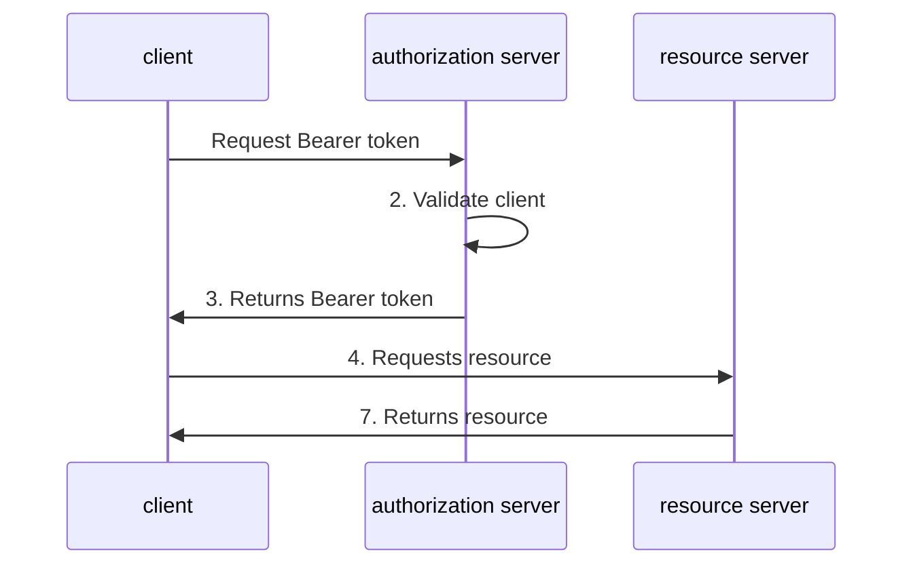

## Authentication

Classical authentication methods like username and password aren't suitable for machine-to-machine communication, such as shell scripts or backend services. On the Dynatrace platform, there are two supported methods for authenticating API access:

- **OAuth Client Credentials Flow** – Recommended for enterprise-grade integrations, delegated access, and secure automation.
- **Platform tokens** – A simpler alternative for individual users, scripts, or internal tools.

This guide focuses on the **OAuth Client Credentials Flow**, where your script or service authenticates using a **Client ID** and **Client Secret** to obtain an access token for API calls.

> **Note**
>
> If you're looking for a more straightforward setup for personal or internal use, consider using a [**Platform token**](https://docs.dynatrace.com/docs/manage/identity-access-management/access-tokens-and-oauth-clients/platform-tokens), which can be used directly in the `Authorization: Bearer <token>` header.

The following diagram illustrates this OAuth-based workflow:

