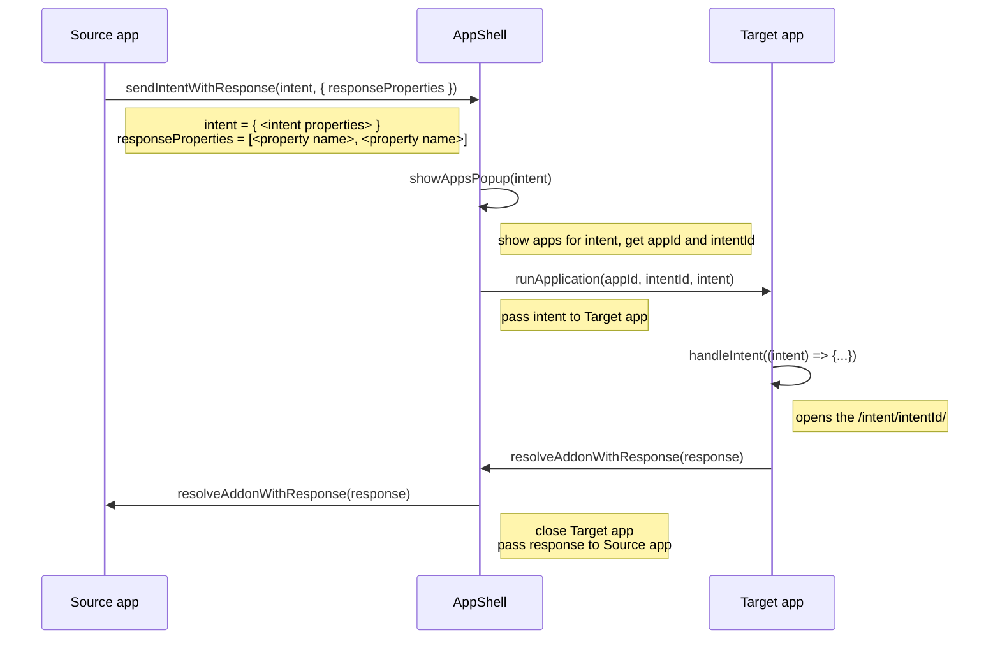

## Send add-on intents

You can send add-on intent in apps. Learn more about how to send an intent in the [Send intents guide](https://developer.dynatrace.com/develop/guides/navigation/intents/send-intents.md).

When sending an intent, the source app can't control the visual mode of the app receiving the intent. However, the target app can opt in to the add-on using the intent's declaration in the app manifest.

```ts title="Intent sent to view a user Session Replay" testable
import { sendIntent, IntentPayload } from '@dynatrace-sdk/navigation';

const intent: IntentPayload = { 'dt.userSessionId': 123 };
sendIntent(intent);
```

Depending on the user's choice in the `Open with...` dialog, the add-on will handle the intent above by navigating from the source app to the target app or showing the target add-on in a modal.

### Intents-with-response

When sending an intent-with-response, the source app can request which properties will be returned by the app receiving the intent.
The source app requests the expected intent response as a list of property names.

> **Tip**
>
> An add-on is required to handle an intent-with-response.

```ts title="Intent sent to refine DPL pattern" skip-testing
import { sendIntentWithResponse, IntentPayload } from '@dynatrace-sdk/navigation';

const result = await sendIntentWithResponse(
  { 'dt.dpl.pattern': dplPatternToRefine },
  { responseProperties: ['dt.dpl.pattern'] },
);

if (result === undefined) {
  return;
}

if (result.ok === true) {
  // Responses come from another app across a trust boundary, so the SDK types
  // each value as `unknown`. Narrow at runtime before using it.
  const pattern = result.data['dt.dpl.pattern'];
  if (typeof pattern === 'string') {
    // use `pattern`
  }
} else if (result.error.reason === 'Rejected') {
  // The responding app explicitly refused to fulfill the intent.
  // `payload` is an app-defined explanation; its shape is a contract between
  // the calling app and the responding app.
  const rejectionPayload = result.error.payload;
  // use `rejectionPayload`
} else if (result.error.reason === 'Canceled') {
  // The user dismissed the picker/response UI before any app handled the intent.
}
```

The intent payload can be empty when sending an intent-with-response.

```ts title="Intent sent to get a user-selected slack channel id" testable
import { sendIntentWithResponse } from '@dynatrace-sdk/navigation';

const result = await sendIntentWithResponse({}, { responseProperties: ['dt.slackChannelId'] });
if (result?.ok) {
  const slackChannelId = result.data['dt.slackChannelId'];
}
```

#### Explicit intent-with-response

When you know exactly which app and intent should handle the response, pass `recommendedAppId` and `recommendedIntentId` in the options object. This skips the `Open with...` dialog and routes directly to the specified app.

```ts title="Intent sent directly to a specific app" skip-testing
import { sendIntentWithResponse, IntentPayload } from '@dynatrace-sdk/navigation';

const intent: IntentPayload = { 'dt.dpl.pattern': dplPatternToRefine };
const result = await sendIntentWithResponse(intent, {
  responseProperties: ['dt.dpl.pattern'],
  recommendedAppId: 'my.dpl-refiner.app',
  recommendedIntentId: 'refine-dpl-pattern',
});
if (result?.ok) {
  const refinedDplPattern = result.data['dt.dpl.pattern'];
}
```

#### Intent-with-response lifecycle


